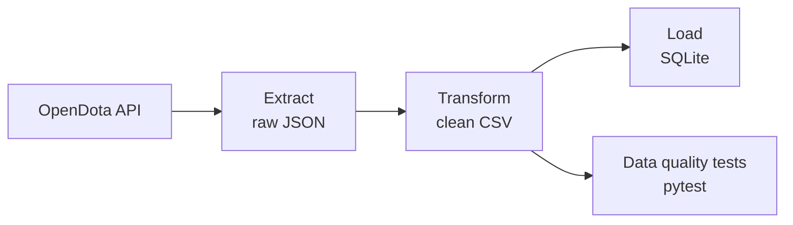

# Dota 2 Pro Match Data Pipeline


An end-to-end ETL pipeline that pulls Dota 2 hero and professional match data from the [OpenDota API](https://docs.opendota.com/), cleans it, validates it with automated tests, and loads it into a SQL database.

## Pipeline



## Tech stack
Python, pandas, requests, SQLAlchemy, SQLite, pytest, Git

## Project structure
```
src/
  extract.py     # fetch data from the API, save raw JSON
  transform.py   # clean data, convert types, add flags
  load.py        # load clean tables into SQLite
  pipeline.py    # run all steps with one command
tests/           # data quality tests
data/            # raw and processed data (not tracked by Git)
```

## How to run
```powershell
python -m venv .venv
.venv\Scripts\Activate.ps1
pip install -r requirements.txt

python -m src.pipeline   # run extract, transform, load
pytest -v                # run data quality tests
```

## Example query
```sql
SELECT winner, COUNT(*) AS wins
FROM pro_matches
WHERE teams_known = 1
GROUP BY winner
ORDER BY wins DESC
LIMIT 5;
```

## Data quality checks
- Hero and match IDs are unique
- Match durations are positive
- Every match has a winner
- Matches with missing team names are flagged (`teams_known = 0`)

## Future improvements
- Add per-match hero picks and join them with the heroes table
- Schedule the pipeline to run daily
- Move from SQLite to PostgreSQL
- Add a dashboard